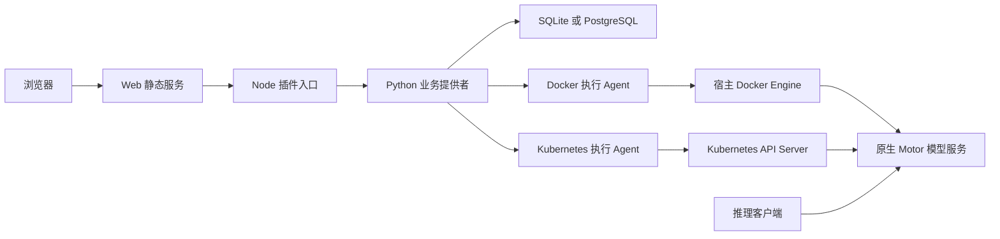

# MindIE-Motor Console

MindIE-Motor Console 是面向 **MindIE-Motor** 的开源部署与运维控制台，为模型配置、Docker/Kubernetes 部署、节点资源、服务日志、监控接入和平台维护提供统一的 Web 操作入口。

控制台独立部署，与原生 MindIE-Motor 分别升级。原生 Motor 负责请求路由、实例管理、P/D 协同及引擎执行；业务推理直接访问模型服务，控制台不承载推理流量。

0.12.0 候选提供可替换的业务与完整 UI：Node 插件宿主、Python Provider SDK 和浏览器 SDK 分层装配，默认参考实现与第三方遵循相同公开合同。发行状态以 Releases 为准，源码候选不等于服务器已升级或真实模型验收完成。见[插件架构](web/ARCHITECTURE.md)和[导入/部署指南](web/docs/PROVIDER_PLUGINS.md)。

## 可以做什么

| 能力 | 范围 |
| --- | --- |
| 模型配置 | 固定原生模板、自定义模板、配置修订、完整原生 JSON 导入与导出。 |
| 部署与生命周期 | Docker 多节点布局与执行、Kubernetes 原生清单适配、预检、启停、重启、任务及资源归属核对。 |
| 节点与设备 | Agent 接入、连接配置、资源明细、镜像管理；区分设备声明、硬件观测、账本和 Kubernetes 资源份额。 |
| 日志与观测 | 服务日志、平台日志、操作审计、Node/NPU Exporter、Prometheus/Grafana 接入及离线配置。 |
| 管理与维护 | 本地账号和角色、OIDC、品牌及外观设置、数据库插件、备份恢复和受信升级计划。 |
| 插件与替换 | 精确提供者绑定、完整 UI/组件/图标/动作制品、Python 业务/Agent 与 Node HTTP 扩展；保留增量社区 SDK，代码均须经审查和明确信任。 |

Docker 的布局建议与最终准入由平台和执行 Agent 协同完成；它不等同于 Kubernetes 的集群调度。Grafana 连接、已有推理网关接入和 CCAE 原生配置也分别有各自的安装、权限及业务验证前提。

## 获取源码

| 获取方式 | 适用范围 |
| --- | --- |
| [Releases](https://github.com/ZhengDeL/MindIE-Motor-Console/releases) | 选择已发布标签及其安装说明，固定源码和实际镜像摘要。 |
| `main` | 当前维护主线，适合贡献和评审；生产安装选择已发布标签。 |

当前正式发行版本为 **0.11.2**，使用固定标签 `v0.11.2`；本分支的 0.12.0 仍为候选。源码、镜像和服务器分别管理；拉取代码不会自动升级已有部署。

当前固定原生适配基线为 `37d615f232a36b8dba8630ffc3a01a20d289c65e`。平台通过受控适配器使用其配置、模板和 deployer 入口；不同运行时并非每个动作都直接执行同一个 `deploy.py`。原生版本、模型镜像及外部依赖的具体兼容范围见[原生集成说明](web/docs/NATIVE_INTEGRATION.md)与[能力矩阵](web/docs/NATIVE_CAPABILITY_MATRIX.md)。

## 开始使用

**部署用户**：先阅读[文档导航](web/docs/README.md)，选择运行时、数据库和网络入口，再按[安装入口](web/DEPLOYMENT.md)准备独立目录、密钥、镜像及 Agent。

以下命令获取 `v0.11.2` 发行源码；如需其他已发布版本，从 Releases 选择对应标签替换 `SOURCE_REF`：

```bash
SOURCE_REF=v0.11.2
git clone --recurse-submodules --branch "$SOURCE_REF" \
  https://github.com/ZhengDeL/MindIE-Motor-Console.git motor-console
cd motor-console
git submodule update --init --recursive
```

GitHub 自动源码压缩包不展开原生子模块。自行构建镜像时应记录源提交、目标架构与镜像摘要；仓库中的示例镜像地址和摘要占位符须由部署方替换。

**本地体验与开发**：按[本地预览指南](web/README.md)启动独立演示环境；无需 Docker、NPU 或模型权重。

**插件作者**：从[插件扩展面](web/PLUGIN_EXTENSION_POINTS.md)选择 Node、Python Provider、完整 UI 或增量社区 SDK，再阅读对应开发指南与源码示例。导入只做校验与暂存，管理员明确选择后在下次启动加载；插件是受信代码，不能用于绕过宿主权限。

## 部署结构



上图是 `web/compose.plugins.yaml` 的三组件插件部署；已有 `web/compose.modular.yaml` 可直接连接 Python API，仍可使用 Python 和 UI 提供者。Web 与 Node 不挂载数据库、节点凭据或 Docker socket；默认 SQLite 适合轻量单实例，PostgreSQL 是可选存储实现，不能据此推定控制台具备多实例高可用。具体安装、精确镜像与切换步骤见[插件部署指南](web/docs/PROVIDER_PLUGINS.md)。

每个独立 Docker 执行宿主通常部署一个 Agent；一个 Kubernetes 集群通常配置一个执行连接，由集群调度 Pod，不为此在每个工作节点重复安装管理 Agent。具体权限和副本按管理边界配置。

Kubernetes 已有 Node/NPU Exporter 时，复用 Prometheus 逐节点抓取及 Grafana 展示；平台执行连接读取的节点资源份额与宿主硬件指标分别处理。详见 [Docker/Kubernetes 采集架构与接入示例](web/docs/KUBERNETES_MONITORING.md)。

## 文档与贡献

- [完整文档导航](web/docs/README.md)：安装、操作、监控、维护、插件及版本说明。
- [系统架构](web/ARCHITECTURE.md)：模块、管理链路、数据库和原生 Motor 的职责。
- [插件扩展面](web/PLUGIN_EXTENSION_POINTS.md)：已实现的替换合同、SDK 与贡献入口。
- [贡献指南](CONTRIBUTING.md)、[安全报告](SECURITY.md)、[许可及第三方来源](NOTICE.md)。

设备观测、资源预留和模型就绪分别展示；缺失或过期的采样保持不可用状态。配置范围与外部依赖见[能力矩阵](web/docs/NATIVE_CAPABILITY_MATRIX.md)。

本项目采用 [Apache License 2.0](LICENSE)。固定原生子模块及其他第三方组件保留各自许可；技术产品标识为 `motor-console`，显示品牌可由管理员配置。
