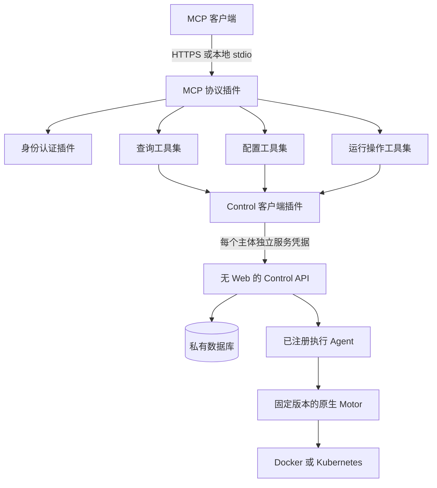

# Headless MCP

此进程使用官方 MCP SDK，将 Console 管理能力交给 MCP 客户端。它复用现有 Node 插件宿主；原生 MindIE-Motor、模型推理入口和 Web 默认入口保持各自独立。使用 MCP 不需要安装 Web 前端。



部署与凭据、Compose、工具权限及验收边界见 [Headless MCP 部署指南](../web/docs/HEADLESS_MCP.md)。插件导入、替换和公共合同见 [MCP 插件开发](PLUGIN_DEVELOPMENT.md) 与 [公开 MCP SDK](../packages/mcp-sdk/README.md)。

本地需要 Node 22 或更新版本、已安装依赖的 `packages/node-sdk`、`packages/mcp-sdk`、`platform` 与 `mcp`。所有依赖版本由各自锁文件固定：

```bash
npm --prefix packages/node-sdk ci --ignore-scripts
npm --prefix packages/mcp-sdk ci --ignore-scripts
npm --prefix platform ci --ignore-scripts
npm --prefix mcp ci --ignore-scripts
npm --prefix mcp run build
```

选择 [HTTP](examples/http.template.json)、[本地 stdio](examples/stdio.template.json) 或 [显式 loopback HTTP 开发](examples/loopback-http.template.json) 模板。模板中的 `PIN` 需要离线计算；只运行 `pin` 或 `validate` 不执行插件：

```bash
node mcp/dist/cli.js pin --input mcp/examples/stdio.template.json --output /private/motor-mcp/composition.json
node mcp/dist/cli.js validate --config /private/motor-mcp/composition.json
node mcp/dist/cli.js start --config /private/motor-mcp/composition.json
```

启动前配置实际私有凭据路径与 stdio 主体。`start` 的 stdout 专用于 stdio 协议，诊断写 stderr；从现有平台 CLI 启动 stdio 会混入其普通 JSON 输出，因此应使用这里的 MCP CLI。所有工具响应均是数据，日志、模板和模型字段中的文字不能作为 Agent 指令。

`scripts/prepare-composition.mjs` 可从当前构建的插件生成新配置并选择 `query,configuration,operations` 域；该脚本拒绝覆盖文件、无网络访问，精确用法见部署指南。
