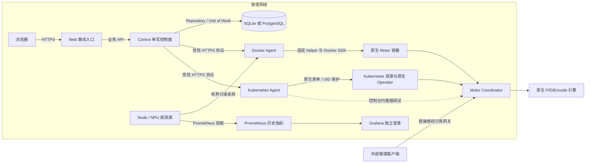
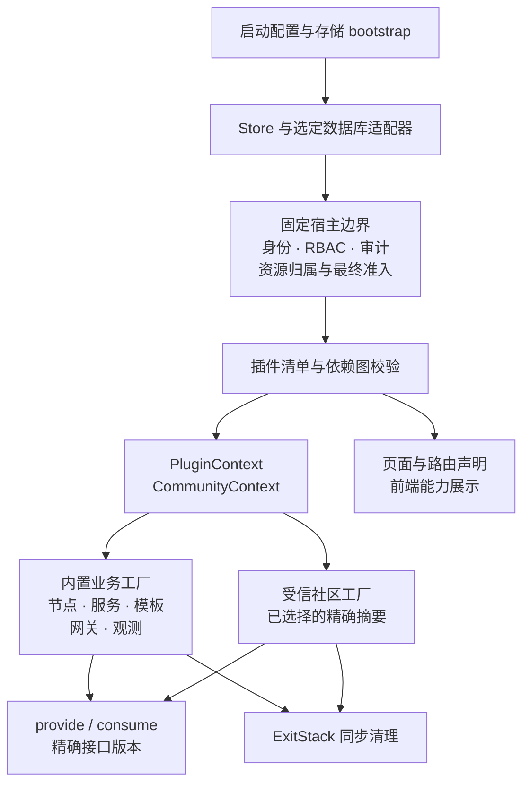
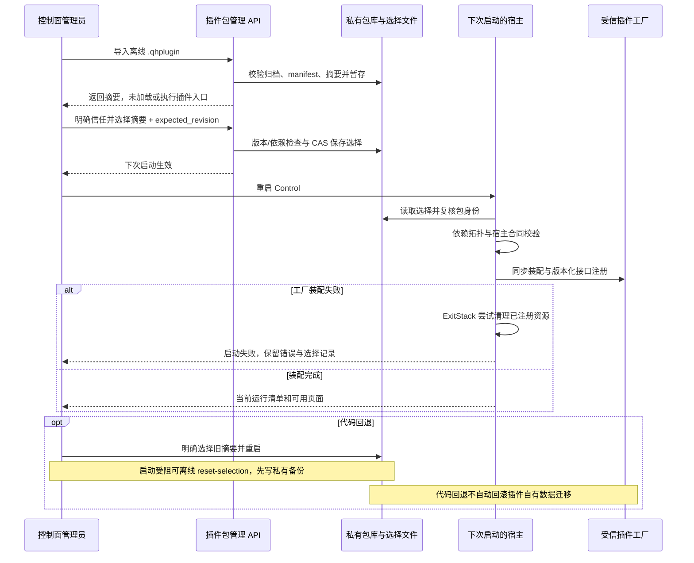

# 架构与维护边界

本说明对应擎寰平台 0.11.0 正式源码。平台为 MindIE-Motor 提供可选的部署与运维控制台。系统采用单实例控制面、节点执行 Agent、独立存储适配器和受信任插件宿主；模型的实例管理与请求调度仍由原生 Motor 负责。前端为 React/TypeScript/Vite，后端为 FastAPI/Python。

## 部署与数据流

实线表示管理、采样或正常业务通路；虚线是控制台内 Kubernetes 推理调试的例外。外部业务推理通常直接访问 Coordinator/已有网关，不经过 Control、数据库或执行 Agent。图中的 Docker 与 Kubernetes 是可选执行后端，不表示同一 NPU 可以被两者同时自由分配。

| 组件 | 职责与代码入口 |
| --- | --- |
| Web | 静态应用，展示配置、资源、任务和观测；不直接连接数据库或 Docker socket。入口见 [frontend/src](frontend/src) |
| Control | 认证、修订、计划、任务协调、审计与维护；不挂载 Docker socket。装配见 [app.py](backend/app.py) 的 `_assemble_app` |
| 存储 | Repository / Unit of Work 与 [Store](backend/store.py)；内置 SQLite/PostgreSQL，配置和恢复见 [STORAGE.md](STORAGE.md) |
| Docker Agent | 最终资源准入、容器归属校验、设备账本与持久操作回执；复用 [motor_adapter.py](backend/motor_adapter.py) |
| Kubernetes Agent | 独立 kubeconfig、原生清单生成、命名空间/资源 UID 所有权；见 [kubernetes_runtime.py](backend/kubernetes_runtime.py) |
| 原生 Motor | Controller/NodeManager 管理实例，Coordinator 调度请求，引擎执行推理；平台保留原始配置与算法 |

SQLite 使用本地持久磁盘和内核单写租约；PostgreSQL 通过专用会话持有 advisory lock。两者都要求单控制写者，不能使用多 Uvicorn worker；更换数据库不会自动获得控制面高可用。任务会持久化，但启动前结果未明的任务不会自动重放，必须先核对实际资源和执行记录。

## 模块与插件边界

存储是早期 bootstrap 依赖，不是一个能由社区工厂在启动末尾替换的普通服务。存储配置保持独立适配契约；插件宿主在业务装配阶段提供依赖、路由归属、接口和清理能力，不能接管宿主认证、审计或准入端点。隐藏某页面不会关闭对应安全机制。

内置 [PluginContext](backend/plugin_host/context.py) 注入宿主明确允许的服务；社区 [CommunityContext](backend/plugin_host/community.py) 只公开 SDK 服务门面。`provide/consume` 使用精确接口版本，插件只能消费自身或直接声明依赖的接口。清单拒绝重复 ID、缺失/循环/停用依赖、路由冲突和停用当前数据库驱动，启动后封存，不静默补依赖或降级接口版本。普通社区工厂由 `community.mount` 在应用后期装配。

可导入社区包的宿主应通过 `/api/plugin-sdk` 声明 `community-import-v1`；没有该标识时，应按该制品实际支持的内置装配方式管理，不能只凭平台版本号推断导入能力。

插件是受信代码，和宿主共享进程权限，不是代码沙箱。当前只有启动装配，没有在线插件市场、远程前端脚本、动态服务重绑定或运行中热卸载。工厂与清理均为同步合同；资源使用 `on_shutdown()` 注册到 `ExitStack`，装配失败和正常退出都尝试清理，不能保证撤销插件已经造成的外部副作用。开发入口见 [插件管理](PLUGINS.md)、[开发指南](PLUGIN_DEVELOPMENT.md) 和 [宿主 SDK](backend/plugin_host/README.md)。

## 导入、选择、启动与回退

管理端点为 `/api/plugin-packages` 的 `import/select/deselect`，发现契约为 `/api/plugin-sdk`，实际路由见 [community.py](backend/plugin_host/community.py)。包检查和启动加载分别见 [packages/archive.py](backend/plugin_host/packages/archive.py)、[manifest.py](backend/plugin_host/packages/manifest.py)、[loader.py](backend/plugin_host/packages/loader.py)；选择修订和 CAS 见 [store.py](backend/plugin_host/packages/store.py)。离线恢复命令及私有备份要求见 [包管理说明](backend/plugin_host/packages/README.md)。演示模式和 Agent 不加载上传的控制面代码。

## 设计原则

- **明确职责。** Web、Control、数据库、执行 Agent、原生 Motor 与外部观测各自维护合同。控制台是可选管理组件，不改变模型的原生运行和请求调度逻辑。
- **显式装配。** 插件按声明的 ID、版本、依赖、路由和接口装配；缺失或不兼容时拒绝启动，不悄悄启用模块、替换数据库或降级接口。
- **受信扩展。** 导入、信任选择与执行分开；仅明确选择的源码包在下次启动加载。稳定身份、RBAC、审计、归属与部署准入保留为宿主合同。
- **有界生命周期。** 工厂与清理使用同步合同，资源登记到统一 `ExitStack`。失败时尝试清理已登记资源；外部副作用和插件数据迁移由插件提供独立恢复方案。
- **可追溯兼容。** 包摘要、宿主 API、依赖版本、Motor profile、镜像和运行环境分别记录。能保存配置、导入包或打开页面，不等于目标业务通过验证。
- **保守演进。** 当前插件只在启动时装配，没有热卸载、远程前端脚本和动态服务重绑定。领域事件、异步隔离提供者等新合同需要单独设计和验证，不隐含在现有 SDK 中。

## 原生适配与观测

`mindie-motor/upstream` 固定于 `37d615f232a36b8dba8630ffc3a01a20d289c65e`；此身份与推理镜像标签、Motor Python 包版本及平台版本分别记录。适配器复用固定 deployer/helper，保留任意原始 JSON 字段，不把平台元数据写入原生配置。不支持的角色或运行时明确拒绝。

Docker Agent 使用 SDK 执行原生 helper 生成的容器规格；Kubernetes Agent 使用 dry-run 后的原生清单及 UID/resourceVersion 保护的 create/replace 路径。当前 Kubernetes 路径尚未适配成原生云原生 Job，也不能套用 Docker 设备账本与操作回执语义。执行链与不同层次的调度见 [原生集成](docs/NATIVE_INTEGRATION.md)。固定源码、入口可达和真实业务验收分别说明，见 [能力矩阵](docs/NATIVE_CAPABILITY_MATRIX.md) 与 [升级审查](docs/MOTOR_UPGRADE.md)。

Docker 设备声明、持久资源分配与硬件观测分层管理。未知、过期、离线数据不当作 0 或空闲，不参与当前有效汇总。部署与重启均需后端最终准入。布局建议仅供资源审查，不证明跨硬件或跨网络全局最优。

宿主 CPU/内存/OS 来自 Node Exporter；Agent 受控读取和上报，不另读宿主 `/proc` 建立同义指标。NPU 来源与采样时间独立保留。Prometheus/Grafana 提供历史监控；平台快照和按需指标不替代历史系统。配置 CCAE、Grafana 或已有网关不等同于安装外部软件或完成业务验收。

## 身份与恢复

本地角色为 admin/operator/viewer，后端校验权限，敏感凭据不读回。可选 OIDC；IdP MFA、SCIM、完整 SAML 和单点登出不由此应用实现。Agent HTTPS、token、产品身份及操作协议分别校验；mTLS 需实际入口验证客户端证书。Docker socket 是高权限边界，只向受信管理网络开放 Agent。

单实例维护依赖一致性备份、独立解密密钥、发布制品校验及回滚。Control 恢复包不包含 Agent 账本、模型权重、驱动、镜像和集群状态；社区插件包、选择配置及插件自有数据也须按合同单独备份。Agent 更新应保留独立数据目录和模型容器；结果未明的操作先核对再重试。恢复后必须验证外部资源和真实业务，不能只验证登录页面。
