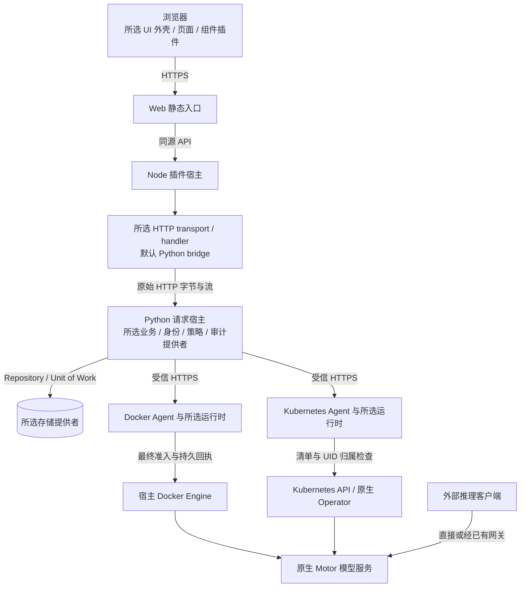
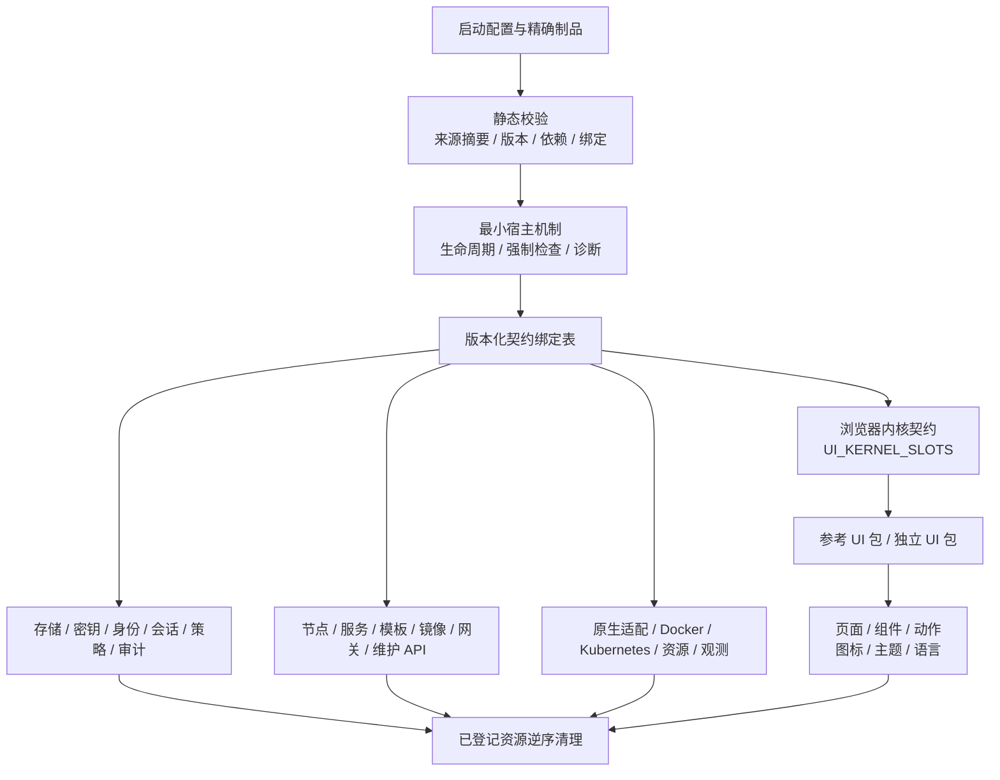
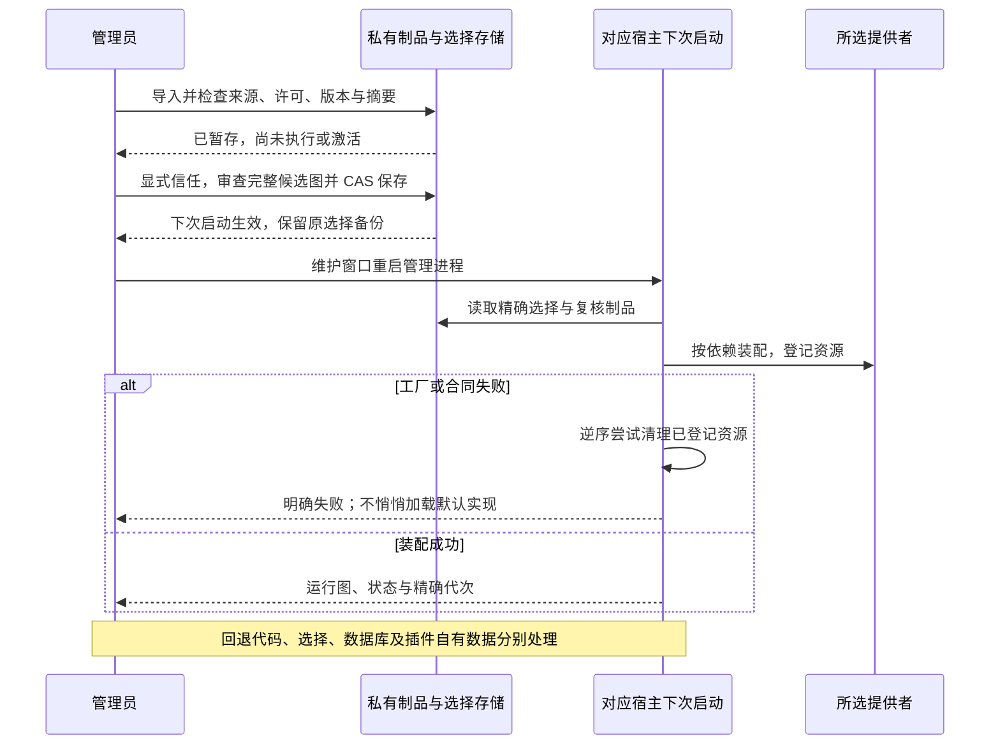
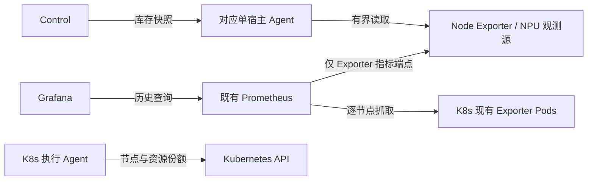

# 架构与维护边界

MindIE-Motor Console 为原生 Motor 提供可选的部署与运维控制台。0.12.0 采用小型宿主、显式提供者绑定和默认参考插件；Node 入口、Python 业务/Agent 与浏览器 UI 各有公开 SDK。具体实现可以替换，原生 Motor 的模型管理和请求调度保持独立。

## 部署与数据流

使用 [compose.plugins.yaml](compose.plugins.yaml) 时 Node 和 Python worker 是私有服务，Web 为独立入口。原有 [compose.modular.yaml](compose.modular.yaml) 可直接访问 Python 请求宿主，使用相同 Python/UI 提供者机制。数据库仍要求单控制写者；添加 Node 入口或更换数据库不自动获得高可用。

外部业务推理不经过 Node 宿主、Control、数据库或 Agent。控制台内推理调试是独立管理功能，K8s 路径可经过执行 Agent。Docker 与 K8s 是执行后端，不表示同一 NPU 能交给两者同时自由分配。

## 契约与提供者装配

默认与第三方通过同一合同和生命周期装配。调用方依赖契约，配置选择具体提供者；重复 ID、错误版本、循环/缺失依赖、无效产物或路由越界均明确失败。关闭默认实现后可以绑定不同 ID 的实现，不靠冒用内置 ID 或静默回退。

UI 选择默认继承参考界面绑定，以兼容局部替换；`inherit_defaults: false` 仅使用显式装配，须满足浏览器内核契约和所选包的依赖。未选中的参考包不贡献页面，也不加载其 App 和业务样式。具体选择、升级与恢复见[浏览器 UI SDK](frontend/sdk/README.md#contracts-and-selection)。

| 边界 | 入口与合同 |
| --- | --- |
| Node | [platform](../platform/README.md)：本地 ESM 制品、完整树摘要、必需/可选/多提供者、启动/清理、代次与离线恢复。 |
| Python | [Provider SDK](backend/provider_host/README.md)、[类型](backend/provider_host/sdk.py)、[可执行目录](backend/provider_host/catalogue.py)：启动前选择、对象/可调用/HTTP 模块合同、精确路由归属。 |
| UI | [浏览器 SDK](frontend/sdk/README.md)：完整 UI 及细粒度扩展点、独立制品、摘要验证、同一 React 单例和生命周期。 |
| 增量社区包 | [原 SDK](PLUGIN_DEVELOPMENT.md)：受保护命名空间的附加 API、声明式页面和后台服务；保留独立版本及包格式。 |

根 ASGI 装配与强制调用授权/审计属于宿主机制。身份源、会话、策略、审计输出和业务处理器本身可替换；正常公开 SDK 路径始终经过这些检查。Node 任意 HTTP handler 与进程内 Python/浏览器代码均属于明确受信实现，不构成恶意代码沙箱；更换整个 HTTP 应用也必须单独验收其认证、授权与业务约束。

存储在业务工厂之前选择。SQLite 使用本地持久磁盘和单写租约，PostgreSQL 使用专用会话 advisory lock；参考实现均不支持多 Uvicorn worker。其他存储提供者须实现完整 Repository/UoW、条件写、审计一致性和恢复合同，不能只暴露数据库连接。

## 参考业务模块与新增扩展

公共 DTO、Protocol 与 typed refs 分别位于独立的 Python/UI/Node SDK 包；参考实现消费同一份定义。服务工作流、任务协调和 HTTP API 位于 `backend/reference_modules`，根程序集只保留装配及强制请求边界。替代 API 从自己的工厂构建，不预先实例化未选参考路由；仅显式要求 v1 `reference_routes` 时才惰性构造对应参考模块。

Python schema v2 可注册独立命名空间契约、逐产品依赖与 HTTP 模块，UI 可贡献完整页面、导航、深链接和自定义服务。新增合规模块不需要改根应用业务分支。架构、独立安装 SDK、脚手架和配对示例见[插件框架](docs/PLUGIN_FRAMEWORK.md)。

## 导入、选择、运行与回退

Node 目录导入、Python `.mcprovider`、浏览器 `.mcui` 与原增量 `.qhplugin` 分开维护合同。导入不运行入口或安装钩子，显式选择不热换当前进程。步骤与命令见 [提供者部署](docs/PROVIDER_PLUGINS.md)。Node 清理共享总截止时间；Python 工厂/清理是同步合同，作者须使用有界、可关闭的资源，不能承诺任意阻塞扩展都能在用户态强制撤销。

UI 启动图和已选静态资产允许登录前只读获取；管理库存、导入和选择受权限保护，写入还校验 CSRF。入口在浏览器按摘要校验，资源来自固定同源制品，不从任意远程 URL 拉取代码。完全未选择默认 UI 时，不加载默认 App、外观和业务样式。

浏览器、Node 入口与 Python 提供者各自固定运行代次。已知旧代次的写请求在副作用前拒绝，不自动重试；草稿保留并提示刷新。前后端构建身份不一致时拒绝混用。

## 观测流向

CPU/内存/OS 来自 Node Exporter，不另读宿主 `/proc` 补成同义指标。硬件观测、资源声明与分配账本分开；过期、离线和未知不当作零或空闲。NPU 文件快照供 Agent 读取，不是 Prometheus 抓取端点。

默认 K8s 路径查询 API 的节点及 capacity/allocatable，不自动汇总全集群 Exporter/PromQL。执行 Agent 的宿主指标仅属于对应宿主，全 worker 指标由既有 Prometheus/Grafana 维护；见 [Kubernetes 采集图和接入示例](docs/KUBERNETES_MONITORING.md)。替换观测提供者也必须保留节点身份、单位、时效和未知语义。

## 原生 Motor 与恢复

`mindie-motor/upstream` 保持 `37d615f232a36b8dba8630ffc3a01a20d289c65e`。源码身份、推理镜像、Motor Python 包版本、插件合同和平台版本分别记录。参考适配器复用固定 deployer/helper，保留任意原生 JSON，不把平台元数据写入模型配置；Node 转发保持原始字节。

Docker 运行时负责最终准入、资源账本、容器归属与回执。K8s 参考运行时负责原生清单与 UID/resourceVersion 检查；当前不是原生云原生 Job 执行器，也不套用 Docker 设备账本语义。不支持的运行时操作明确拒绝，见 [原生集成](docs/NATIVE_INTEGRATION.md)与[能力矩阵](docs/NATIVE_CAPABILITY_MATRIX.md)。

持久任务、Agent 操作回执、独立提供者身份及未决副作用分别保存。存在未知操作或受管资源时，不能盲目更换关键存储/运行时或认领已有容器。UI/API 的普通变更与关键执行器变更分别判断，不因换图标而停止模型。备份、旧制品、独立密钥及插件自有状态均需保留；控制面恢复包不包含权重、驱动、镜像、Exporter 或完整集群状态。

当前支持启动时装配与明确回退，不提供任意插件在线热卸载、插件市场、恶意代码沙箱、自动跨数据库迁移或自动高可用。结构校验、本地替换测试、浏览器验收、Linux 容器及真实模型/集群验收是不同证据。
