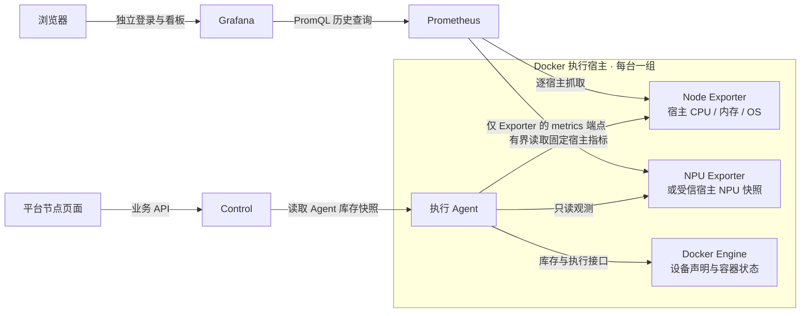
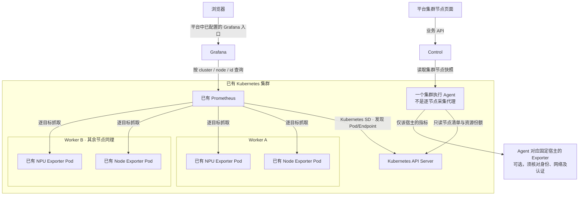

# Kubernetes 监控接入与指标流向

Kubernetes 已安装 Node Exporter、Ascend NPU Exporter 时，复用集群已有采集器和 Prometheus；不再逐节点安装 Docker Exporter，也不为采集增加执行 Agent。Exporter 的容器安装方式不会改变指标职责：Node Exporter 采集宿主 CPU、内存、OS、磁盘和网络，NPU Exporter 采集其版本支持的设备指标。

本页说明当前实现、接入配置和验收方法。图中箭头表示请求发起方向，响应沿原路返回。示例命名空间、标签、端口与地址均需按实际安装替换；配置示例不代表目标集群已完成验收。

## 1. 三类数据分别从哪里来

| 数据 | 来源与链路 | 当前展示及边界 |
| --- | --- | --- |
| Kubernetes 节点、Ready、标签、NPU capacity/allocatable | Kubernetes API → 执行 Agent → Control | 集群节点与调度资源份额；不是已申请量、实时空闲或利用率。 |
| 执行 Agent 所在宿主的 CPU、内存、OS 与 NPU 观测 | 固定宿主 Exporter → Agent → Control | 只覆盖该 Agent 对应宿主；不能代指全部 worker。NPU 仍需已核实的设备映射。 |
| 全集群逐宿主、逐设备指标与历史曲线 | 每个 Exporter 实例 → 既有 Prometheus → Grafana | 逐目标抓取，保留集群、节点和设备身份；由集群侧维护发现、认证、保留期和告警。 |
| Motor 模型吞吐、请求与角色指标 | 原生 Coordinator/引擎指标端点 | 与 Node/NPU Exporter 分开配置；平台按需快照和 Prometheus 历史抓取分别管理。 |

**当前未实现**：一个 Kubernetes 执行 Agent 自动发现所有 Exporter、从 Prometheus 查询全集群指标，再将结果写入每个 worker 的平台资源详情。配置 Grafana 连接只提供导航和只读连接检查，不会自动把 Grafana 面板同步成平台节点字段。集群所有节点的硬件趋势应在已接入的 Grafana 看板查看。

### Docker：每台执行宿主独立采集



受信宿主 NPU 文件快照仅供 Agent 读取，不能直接作为 Prometheus 抓取端点；需要 NPU 历史曲线时另接实际 NPU Exporter。Agent 数据来源和缓存规则见 [Node Exporter](DOCKER_NODE_EXPORTER.md)、[NPU 采集](DOCKER_NPU_EXPORTER.md)及[资源管理](../RESOURCE_MANAGEMENT.md)。

### Kubernetes：复用每节点 Exporter，执行连接独立



图中 Prometheus 为执行服务发现而读取 API，随后直接抓取每个 Exporter 目标；硬件指标不经 Kubernetes API 转发。执行 Agent 可以在集群外，图中位置表示管理归属，不要求以 Pod 安装。若它不在 worker 上，其宿主采样也不代表任一 worker。

## 2. 优先复用已有抓取配置

先由集群管理员核对以下对象；命令只读，使用已有授权 kubeconfig：

```sh
kubectl get daemonsets,pods,services -n monitoring -o wide
kubectl get daemonsets,pods,services -n npu-exporter -o wide
# 仅在已安装 Prometheus Operator CRD 时查询：
kubectl get prometheuses,podmonitors,servicemonitors -A
```

实际 namespace 不一定叫 `monitoring` 或 `npu-exporter`。检查 DaemonSet 的期望数、就绪数、nodeSelector/容忍以及 Pod 所在节点，确认所有目标宿主被覆盖；NPU Exporter 只需覆盖有对应设备的节点。查看现有 Monitor 和 Prometheus Targets，若已成功逐实例抓取，直接使用这套数据，不新建重复 Monitor。

不要假设所有 Exporter 都是 `http://NodeIP:端口/metrics`：

- Node Exporter 可能通过 kube-rbac-proxy 暴露 HTTPS，并需要令牌与相应授权；核对现有 ServiceMonitor 的端口、CA、服务名和认证合同。下方链接的 kube-prometheus 主线示例包含 `insecureSkipVerify: true`，只用于说明其 HTTPS/令牌布局，不应原样当作生产信任配置；接入时验证实际 CA 与证书名称，不为连通而关闭校验。
- Ascend NPU Exporter 的固定官方 DaemonSet 示例使用 Pod 网络、名为 `http` 的 8082 端口，没有设置 `hostNetwork`。能访问节点 IP 不代表能访问该 Pod 指标。
- 集群内 Prometheus 能访问 Pod 网段，不代表集群外 Agent 或 Docker Prometheus 也能访问。需要规划真实可达路径和 NetworkPolicy；不要为了监控把所有 Exporter 对公网开放。

## 3. 有 Operator：选择已有 Monitor，必要时补 PodMonitor

选择关系分两层，不能互换：

| 配置位置 | 选择什么 |
| --- | --- |
| Prometheus CR 的 `podMonitorSelector` / `serviceMonitorSelector` | Monitor 的 `metadata.labels`。 |
| Prometheus CR 对应的 `*MonitorNamespaceSelector` | Monitor 所在 Namespace 的标签，使用 LabelSelector。 |
| PodMonitor 的 `spec.selector` | Exporter Pod 标签。 |
| ServiceMonitor 的 `spec.selector` | Exporter Service 标签；随后发现各 Endpoint。 |
| Monitor 内部的 `namespaceSelector.matchNames` | 目标 Pod/Service 所在命名空间。 |

PodMonitor 的端口名称来自 **Pod 容器端口**；ServiceMonitor 的端口名称来自 **Service 端口**。二者都是逐目标发现，不是抓取一个负载均衡地址后推测节点。

下面示例只适用于与固定官方示例一致的 NPU Exporter：`app=npu-exporter`、Pod 端口名 `http`、HTTP `/metrics`。已有 Monitor 时不再应用；若现有安装使用 HTTPS/认证或其他标签，按实际配置修改。

```yaml
apiVersion: monitoring.coreos.com/v1
kind: PodMonitor
metadata:
  name: motor-console-npu-observation
  namespace: monitoring
  labels:
    monitoring-instance: main
spec:
  namespaceSelector:
    matchNames: [npu-exporter]
  selector:
    matchLabels:
      app: npu-exporter
  podMetricsEndpoints:
    - port: http
      path: /metrics
      interval: 30s
      scrapeTimeout: 10s
      honorLabels: false
      relabelings:
        - sourceLabels: [__meta_kubernetes_pod_node_name]
          targetLabel: node
        - targetLabel: cluster
          replacement: example-k8s
        - targetLabel: job
          replacement: npu-exporter
```

`monitoring-instance: main` 是示例选择标签，必须满足现有 Prometheus 的选择器，且 Prometheus 必须选择该 Monitor 所在 namespace。Prometheus CR 的 `*MonitorNamespaceSelector` 使用 LabelSelector，不是 `matchNames`；不要为一个示例放开所有集群命名空间。NetworkPolicy 还须允许实际 Prometheus Pod 访问。

对 Node Exporter 优先复用已有 ServiceMonitor，在确认现有看板和告警兼容后，用目标重标记补充 `cluster`、`node` 以及需要的 `job=node-exporter`；保留原来的 HTTPS、端口名与令牌配置。修改 `job` 会影响旧查询，不能直接覆盖客户配置。

## 4. 无 Operator：使用 Prometheus 原生发现或逐节点目标

已有普通 Prometheus 可在经审查的抓取配置中使用 Kubernetes SD。以下示例同样针对上述 NPU Exporter Pod，追加到既有 `scrape_configs`，不替换整个配置：

```yaml
scrape_configs:
  - job_name: npu-exporter
    scrape_interval: 30s
    scrape_timeout: 10s
    honor_labels: false
    kubernetes_sd_configs:
      - role: pod
        namespaces:
          names: [npu-exporter]
    relabel_configs:
      - source_labels: [__meta_kubernetes_pod_label_app]
        regex: npu-exporter
        action: keep
      - source_labels: [__meta_kubernetes_pod_container_port_name]
        regex: http
        action: keep
      - source_labels: [__meta_kubernetes_pod_phase]
        regex: Running
        action: keep
      - source_labels: [__meta_kubernetes_pod_node_name]
        target_label: node
      - target_label: cluster
        replacement: example-k8s
```

此例按集群内 ServiceAccount 认证访问 API。Prometheus 在集群外时须另配受信 API 地址、CA、凭据及目标 Pod 网络可达性；API 读取权限按实际发现资源收敛，不能直接复用执行 Agent 的高权限凭据。配置中 `__meta_kubernetes_*` 标签只存在于目标重标记阶段；Operator 用 `relabelings`，原生配置用 `relabel_configs`。

不能使用动态发现时，可以由管理员维护 `file_sd` 逐目标清单，每项明确 `cluster/node`。地址须稳定且唯一指向对应宿主；Pod 重建换 IP 后必须更新。现有 [Docker 观测准备脚本](../observability/README.md)只接收静态 `HOST:PORT`，默认以 host 作为 `node`，不安装 Operator，也不会自动发现 K8s Pods。Node 与 NPU 若通过不同 Pod IP 暴露，不能直接用两者的 IP 当作同一节点名。

## 5. 让已有数据兼容宿主与 NPU 看板

本仓库两个宿主/NPU 看板和 CPU 记录规则的连接键如下：

| 标签 / 配置 | 要求 |
| --- | --- |
| `job` | 宿主为 `node-exporter`，NPU 为 `npu-exporter`；需同时作用于指标和自动生成的 `up`。 |
| `cluster` | 同一实际集群用同一稳定标识，不同集群区分；抓取目标和 `up` 都带此标签，不能只依赖远程写入用的 `external_labels`。 |
| `node` | Kubernetes `spec.nodeName`；同一宿主的 Node/NPU 目标一致。不能填负载均衡 Service IP 或各自不同的 Pod IP。 |
| `id` | NPU Exporter 的设备标识；逐设备连接键为 `cluster/node/id`，不擅自改写成物理卡数。 |
| 数据源与规则 | Grafana 数据源 UID 为 `prometheus`；CPU 历史需要加载 `qinghuan:host_cpu_busy_percent:rate2m` 记录规则。技术标识按兼容合同保留。 |

上面的示例使用抓取前的目标重标记，因此 `up` 也获得相同身份。只在 `metricRelabelings` 中改业务指标不能修复 `up`；那里也不能再读取已被移除的 `__meta_*` 标签。已有多副本/HA 数据源要先按组织方案去重，不能对同一设备重复求和。

若客户现有 `job` 与标签不能改，应复制并适配看板及记录规则查询，而非新增一套重复抓取。把本仓库 [observability/dashboards](../observability/dashboards) 的两个宿主/NPU JSON 导入已有 Grafana，按[观测手册](../observability/README.md)加载 [host-npu.rules.yaml](../observability/rules/host-npu.rules.yaml)；Operator 管理的 Prometheus 使用被其规则选择器选中的 PrometheusRule，普通实例使用 `rule_files`。不要直接改 Operator 生成的配置文件。当前值超过 90 秒、抓取失败、设备来源重复或字段缺失时应留空，不补零。

## 6. Agent 的直采 URL 仍是单宿主合同

仅当需要展示执行 Agent 自己宿主的硬件信息时，配置其已核实来源：

| Agent 配置 | 含义 |
| --- | --- |
| `MOTOR_NODE_EXPORTER_URL` | 单一对应宿主的 `/metrics`；默认 loopback 仅在网络与实际监听均匹配时有效。 |
| `MOTOR_NODE_EXPORTER_ALLOWED_HOSTS` | 允许的 DNS 名；HTTPS CA、令牌或 Basic Auth 使用相应只读文件配置。 |
| `MOTOR_NPU_METRICS_URL` | 同一宿主的 NPU `/metrics`；CA/令牌和 allowed hosts 独立配置。 |
| `MOTOR_NPU_DEVICE_MAP_JSON` | Exporter `id` → 已核实宿主物理设备索引映射；不能跨节点拼接。 |
| `MOTOR_NPU_SNAPSHOT_FILE` | 若配置且受信快照有效，优先于 NPU Exporter。K8s 复用采集器不要求新装宿主采集定时器。 |

**不要把多后端 ClusterIP、Headless DNS 或 Prometheus 聚合接口填入上述单宿主 URL。** 它们不能保证每次返回同一宿主的原始指标；轮流命中不同节点会造成身份和 CPU 差分错误。当前 Agent 不解析 PromQL JSON，也不执行按节点的 Prometheus 查询。即便 URL 可访问，仍须核对来源身份、鉴权、指标格式和采样时效。

## 7. 模型指标、trace 与验收

Node/NPU Exporter 不提供 Motor 请求吞吐、P/D 角色时延或调用链。模型指标须独立发现真实 Coordinator/引擎端点，按原生配置及生成清单核对地址、TLS 和标签；参见[服务指标](SERVICE_METRICS.md)与固定原生[观测案例](../../mindie-motor/upstream/examples/features/observability/stack/README.md)。不要把宿主 `node` 与原生模型实例、角色标签混为一谈。

本仓库轻量观测模块只部署 Prometheus/Grafana/HTTPS 入口；trace 需要额外的 OpenTelemetry Collector/Tempo 等链路后端，日志历史需要实际日志采集与存储。原生参考栈中的开发地址、凭据、保留期和端口不能未经审查直接套用生产。

接入完成后逐项验证：

1. Prometheus Targets 中每个目标的实际地址、抓取状态、TLS/认证和错误；覆盖节点与期望 DaemonSet 一致。
2. `up{job=~"node-exporter|npu-exporter",cluster="example-k8s"}` 保留各目标；对照 `count by (job,cluster,node) (...)` 查重，不能只数总量。`up=1` 不代表指标完整。
3. Node/NPU 目标的 `node` 逐一匹配；型号、HBM 单位/容量、健康枚举和设备 ID 与固定版本的真实输出一致。未知 PID 命名空间不推定为宿主进程。
4. Grafana 数据源连接、看板查询、CPU 规则、中文名称、时间范围与逐设备明细；缺测/陈旧/重复来源时保留空值。
5. 平台集群节点仍展示 API 资源份额，不把 Grafana 利用率解释为部署可用量；单 Agent 宿主指标不覆盖 worker 列表。
6. 观测配置变更不重建模型、驱动或已有 Exporter；完成配置校验后只更新相关观测对象。以上检查仍不替代真实模型推理验收。

## 官方参考与实现入口

- [Prometheus Operator：ServiceMonitor / PodMonitor](https://prometheus-operator.dev/docs/developer/getting-started/)、[选择器与设计](https://prometheus-operator.dev/docs/getting-started/design/)、[API 合同](https://prometheus-operator.dev/docs/api-reference/api/)。
- [Prometheus Kubernetes SD 与目标重标记](https://prometheus.io/docs/prometheus/latest/configuration/configuration/#kubernetes_sd_config)。
- [Ascend NPU Exporter 固定 DaemonSet 示例](https://github.com/Ascend/mind-cluster/blob/6cb6683c8b73d1c26341bb81a2c1cefe12a855ca/component/npu-exporter/build/npu-exporter.yaml)；本页仅参考端口、标签与网络声明，该模板镜像标签仍是 `v5.0.RC1`，不能当作 Docker 手册的 v26.2 镜像安装清单，也不表示已安装集群恰好使用此版本。
- [kube-prometheus Node Exporter DaemonSet](https://github.com/prometheus-operator/kube-prometheus/blob/main/manifests/nodeExporter-daemonset.yaml)、[已有 ServiceMonitor 的 TLS/认证示例](https://github.com/prometheus-operator/kube-prometheus/blob/main/manifests/nodeExporter-serviceMonitor.yaml)；这是可变主线参考，应按客户实际版本核对。
- 当前实现：[Node Exporter 适配](../backend/node_exporter.py)、[NPU 适配](../backend/resource_telemetry.py)、[Agent 库存](../backend/node_agent.py)、[K8s 节点 API](../backend/kubernetes_runtime.py)、[看板与规则生成器](../scripts/build_host_npu_dashboards.py)。
