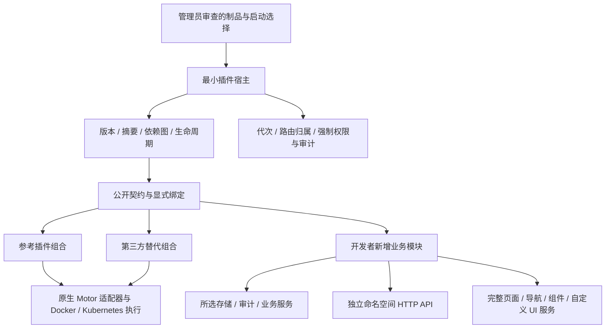

# 插件框架与开发者入口

MindIE-Motor Console 将装配机制、公共契约和参考实现分别维护。平台提供可运行的参考组合，开发者可以替换组合中的业务、存储、安全、运行时和界面，也可以声明自己的契约、HTTP 模块与完整页面。开发新的合规模块不需要修改根应用的路由分支。

原生 MindIE-Motor 仍负责模型服务和推理数据面。本框架不重写原生调度器，不将业务推理流量绕经控制台。

## 骨架与参考实现



宿主负责装配、制品校验、依赖顺序、运行代次和失败诊断；这些机制不作为可绕过的业务插件。身份、会话、策略、审计与具体业务实现是可选择的提供者，宿主强制调用实际选择的安全接口。缺失实现、版本冲突、工厂失败或错误路由归属会明确拒绝启动，不静默换回参考实现。

参考 API 位于 `web/backend/reference_modules`。服务生命周期与任务协调分别实现 `services.workflow`、`tasks.coordinator`，HTTP 模块使用所选工作流和任务端口。根 `default_console.py` 只承担装配、公共健康信息和强制请求边界。参考 API 与替代 API 经过同一工厂路径；独立替代 API 不会预先创建未使用的参考路由或运行时。

## 三种独立 SDK

| 范围 | 安装包与公开入口 | 参考工程 |
| --- | --- | --- |
| Python 服务、存储和 HTTP | [`motor-console-sdk`](../../packages/python-sdk/README.md)，DTO、Protocol、Repository/UoW、`ContractRef[T]` | [Notes 服务/API](../plugins/examples/notes-provider/README.md) |
| 浏览器页面和设计系统 | [`@mindie-motor/ui-sdk`](../../packages/ui-sdk/README.md)，公共 props/DTO、typed slot refs、客户端与生命周期 | [独立 Notes 页面](../frontend/sdk/examples/extension-page/README.md)、[草稿页面](../frontend/sdk/examples/draft-page/README.md) |
| Node 进程宿主 | [`@mindie-motor/host-sdk`](../../packages/node-sdk/README.md)，类型化契约、生命周期和 HTTP 流接口 | [独立维护处理器](../../platform/examples/maintenance-provider/README.md) |

SDK 版本与 Console 版本独立。发布附件中的 wheel/tarball 可安装到独立开发目录；源码包和 npm/PyPI 注册表发布是不同交付形式，不假设注册表已有同名版本。参考应用消费同一份公共定义，不从私有组件实现反推公开 props，也不要求开发者导入后端内部模块。

原 `.qhplugin` 增量扩展格式继续兼容，适合受保护附加 API 和声明式状态表；它与完整 Provider/UI/Node 格式分别维护，不能互换。具体字段、CLI 和恢复步骤见[提供者部署](PROVIDER_PLUGINS.md)。

## 从独立目录开始

先安装[开发环境](../README.md)和所需 SDK，构建 Node 宿主后再使用 Node 相关命令。在仓库根运行：

```sh
python web/scripts/plugin_dev.py init --kind provider --id acme.notes --namespace acme-notes --directory /work/acme-notes
python web/scripts/plugin_dev.py init --kind ui --id acme.notes-ui --namespace acme-notes --directory /work/acme-notes-ui
python web/scripts/plugin_dev.py init --kind node --id acme.maintenance --directory /work/acme-maintenance
```

目标目录必须尚不存在，工具不覆盖已有工程、不安装依赖、不运行模板入口。Python 例子提供真实持久化便笺服务和 API；UI 例子使用同一命名空间调用 API，不用浏览器内存模拟后端。Node 例子明确返回维护 503。每个模板包含 README 和 LICENSE。

UI 项目在自己的目录安装已审查 SDK tarball 和锁定工具链，再显式运行 README 中的类型检查/构建。构建后检查、打包：

```sh
python web/scripts/plugin_dev.py check /work/acme-notes
python web/scripts/plugin_dev.py pack /work/acme-notes --output /work/acme-notes.mcprovider
python web/scripts/plugin_dev.py check /work/acme-notes-ui
python web/scripts/plugin_dev.py pack /work/acme-notes-ui --output /work/acme-notes.mcui
python web/scripts/plugin_dev.py check /work/acme-maintenance
python web/scripts/plugin_dev.py pack /work/acme-maintenance --output /private/console/artifacts
```

`check` 只检查对应格式、元数据和内容完整性，不执行工厂、不做类型检查、不证明生产兼容。UI 必须已有构建产物且产物清单与源码一致。Node 的输出是摘要命名的制品目录；Python/UI 输出分别是 `.mcprovider`/`.mcui`。导入、选择、重启和实际验收是后续独立步骤。

## 新业务契约与完整页面

Python schema v2 保留 v1 读取能力，允许声明 `ext.<namespace>.<name>` 契约。作者给出精确版本、方法、属性及每个产品的依赖，再在启动装配中显式绑定提供者。一个包可同时提供业务服务和 HTTP 产品，使用 `contract_dependencies` 表达“HTTP 依赖同包业务服务，业务服务依赖所选存储和审计”，不会被误判成包级自循环。

HTTP 贡献必须完整声明 `/api/plugins/<namespace>` 下的路径、方法和已登录角色；禁止抢占核心路径、公共匿名入口、任意挂载和 catchall。只读账号永久只读，包含 `viewer` 的声明仅接受 GET/HEAD/OPTIONS；不兼容声明在工厂运行前拒绝。普通写入需管理员或运维角色、有效 CSRF、当前代次和审计准入。执行前和结果审计分别记录，结果未知不得自动重放。

UI 清单可声明自己的 component/service slot 以及 `contributes.pages`。页面包含包前缀 ID、组件槽位、`extensions/<package-id>/<leaf>` 路径、角色、分组及排序。宿主自动装配导航、全局搜索和深链接；API 仍独立授权。自定义服务声明版本及方法，`defineSlot<T>` 同时为调用方提供类型检查和运行时版本检查。

默认页面也从贡献目录装配。未选择默认 UI 时保留用于验证的合同元数据，不导入其 App、CSS 或业务组件。自定义页面需使用宿主 React 单例和 `useUnsavedChanges`，保持焦点、键盘、disabled/ref 语义，避免把业务权限当作菜单可见性。

## 状态、升级与失败语义

语言按组件职责选择：Python 保持原生 Motor 适配、业务和现有部署生态的直接集成；TypeScript 为 Node 宿主和浏览器提供可独立消费的强类型契约。新增 Rust 进程可以通过版本化协议接入，但重写语言本身不能替代事务、资源归属、幂等、权限和失败恢复。本版不为追逐语言更换原生执行逻辑；稳定接口和可验证边界是维护重点。

包版本、契约版本、SDK 版本、原生 Motor 版本和数据 schema 各自记录。兼容范围需作者明确声明；不因版本字符串相近就跳过验证。装配固定到一次进程生命周期，正在运行的页面携带实际代次，已知旧代次写入在副作用前拒绝，保留草稿并提示刷新。

数据库插件负责 Repository/UoW、条件写、审计一致性、备份和恢复，不能只返回一个 SQL 连接。自定义业务数据通过所选 Store 保存，写事务经所选 Audit；插件不关闭其他提供者的资源。外部资源或未知回执存在时，不能盲目更换关键执行/存储绑定。旧回执没有足够的执行器身份时应停止并按[升级与恢复](PROVIDER_PLUGINS.md)对账，不删除回执来绕过保护。

Python/Node 同进程插件和浏览器插件是受信代码。依赖权限与公共 facade 用于保持模块边界，不提供恶意代码隔离；摘要是内容标识，不是签名。当前不提供任意热卸载、自动跨数据库迁移、插件市场或多实例高可用。第三方模块必须有自己的有界工作、失败处理、权限、升级和数据恢复验证。

## 贡献与验收

提交插件时说明契约、依赖、数据来源、副作用、角色、生命周期、取消/超时、持久化、升级及回退。至少验证独立 SDK 安装、类型正反例、导入未执行、选择后重启、真实读写、权限/CSRF/旧代次、失败及恢复。UI 另检查导航、深链接、草稿、键盘和深浅主题。源码和说明按[贡献指南](../../CONTRIBUTING.md)提交，测试与私有验收材料保留本地。

设计采用显式依赖、版本化接口、声明式贡献和生命周期管理。可参考 [Backstage 服务与依赖注入](https://backstage.io/docs/backend-system/architecture/services/)、[VS Code 扩展能力边界](https://code.visualstudio.com/api/extension-capabilities/overview)和 [Grafana 插件类型](https://grafana.com/developers/plugin-tools/key-concepts/plugin-types-usage)。采用这些成熟机制不等于本项目已经具有同等生态规模；本版实际验证与限制见[版本说明](RELEASE_0.12.0.md)。
