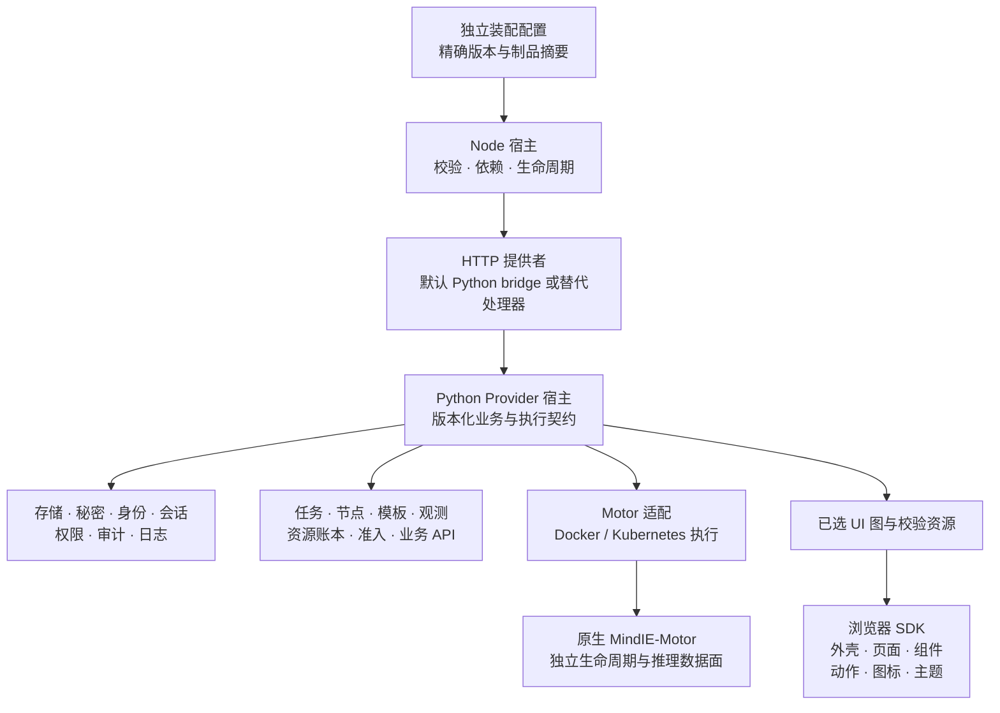
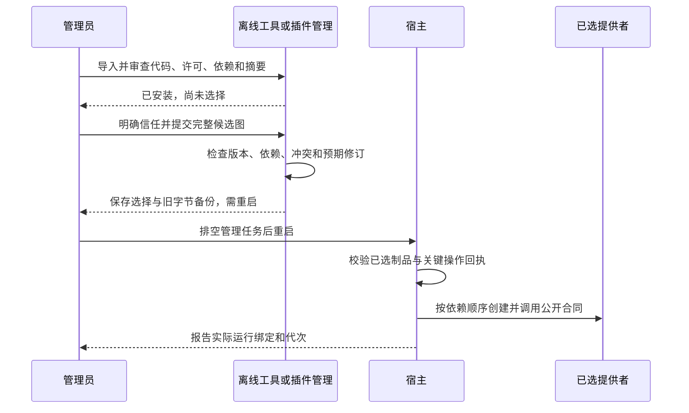

# 可替换插件架构

本页描述 0.12.0 的实际实现。完整系统图见[系统架构](../ARCHITECTURE.md)，操作步骤见[提供者导入与部署](PROVIDER_PLUGINS.md)，契约清单见[插件扩展面](../PLUGIN_EXTENSION_POINTS.md)。已发布标签、镜像和服务器各自管理，源码发布不表示已升级生产环境。

## 最小宿主与参考实现

项目由宿主机制、公开 SDK、精确装配配置和参考插件组成。业务模块不依赖默认包 ID 来定位实现；管理员可以选择自己的提供者。默认与第三方接受相同的版本、依赖、接口和制品检查。

宿主保留启动、制品校验、契约解析、依赖顺序、生命周期、请求强制检查和故障诊断。登录方式、数据库、安全策略、业务 API、执行适配和完整 UI 属于可选实现。保留强制检查不等于绑定某个具体安全实现：每个受保护请求仍必须调用所选授权合同，关键写入仍必须有审计结果。

Node 是可独立部署的入口，已有独立 Web/Python 安装仍可直接使用 Python 提供者和浏览器 SDK。Node 不持有数据库、Docker socket 或 NPU；Python 根 ASGI 装配是宿主内部机制，不接受第三方覆盖。原生 Motor 的 Coordinator、Controller、NodeManager 和引擎不被此架构重写。

## 三个 SDK 的职责

Node SDK 负责 HTTP 入口和进程桥接，Python SDK 负责业务、存储与 Agent 执行，浏览器 UI SDK 负责界面与交互。按执行边界选择 SDK，具体契约与交付格式见[插件扩展面](../PLUGIN_EXTENSION_POINTS.md)，独立安装和脚手架见[插件框架](PLUGIN_FRAMEWORK.md)。

保留的 [`.qhplugin`](../PLUGIN_DEVELOPMENT.md) 是增量 HTTP 与声明式状态页 SDK，与上述三种格式分别维护，不能互换。

Python 内置实现提供 SQLite/PostgreSQL 参考存储；第三方存储须实现完整契约，平台不自动迁移数据。浏览器插槽以[实际清单](../frontend/public/ui-default-manifest.json)为准；替换整个默认包后，不导入其应用和业务样式，也不隐式回退来隐藏缺失依赖。

## 装配与切换

每个请求固定宿主代次。Node 原始转发保留 HTTP 字节，不经 JavaScript 数值转换；原生 JSON 的大整数和未知字段不会因为入口桥接而被重新编码。UI、外层宿主和 Python 提供者代次共同参与写请求校验；不匹配时在副作用前拒绝，而不是自动重试。

存储和执行器替换需要核对受管资源、任务与 Agent 回执。存在未知结果时禁止盲目换关键提供者；普通 UI 或只读 API 变更不应误判为执行器变更。切回旧代码只恢复选择和代码，不自动撤销远端操作或数据迁移。

插件失败时不隐式选择默认包。离线 CLI 能在不执行故障插件的情况下校验、备份并恢复选择；损坏的 JSON 通过原始字节摘要前置条件恢复。恢复入口不开放免认证管理服务。

## UI 与业务隔离

按钮、图标和页面可以换实现，但写入仍使用后端授权接口；隐藏按钮不替代权限检查。页面有受控草稿、加载、空数据、失败、刷新和生命周期合同。入口与资源经摘要验证，同一个 React 单例避免重复运行时。

默认主题、布局和组件是普通选择，完全未选时不加载。宿主只保留最小启动与失败诊断。一个插件包可以实现整套 UI，也可只实现图标或动作集合；无需把每个按钮拆成独立发布包。插件自有的 DOM、异步任务和订阅由其生命周期清理，不通过任意覆盖全局点击事件实现替换。

同进程 Python/Node 插件和同浏览器上下文 UI 都是受信代码，摘要不等于作者认证，也不构成沙箱。执行权限来自容器、运行账号与网络部署；第三方依赖需要另外固定、审查和扫描。

## 语言取舍

业务与原生适配使用 Python，Node 宿主和浏览器 UI 使用 TypeScript。跨边界依赖版本化契约、字节传输与运行期校验；静态类型不替代实际验证。

## 验收边界

实际验收应分别证明：独立插件替换、未选包不执行、缺失/循环/冲突拒绝、授权/CSRF、代次拒绝、损坏配置恢复、生命周期、断开与超时、UI 键盘/焦点/草稿，以及目标架构容器内导入和重启后的真实绑定。默认业务还需逐页、逐接口回归。

SDK 本身的替换验证不等于所有第三方实现都通过生产验收。新增数据库的真实迁移和恢复、真实 NPU 模型、Kubernetes、Exporter、CCAE、网关和 Grafana 各自需要对应环境。当前不提供运行中任意热卸载、自动跨库迁移或多实例高可用；贡献方须明确自己实现及验证的边界。
