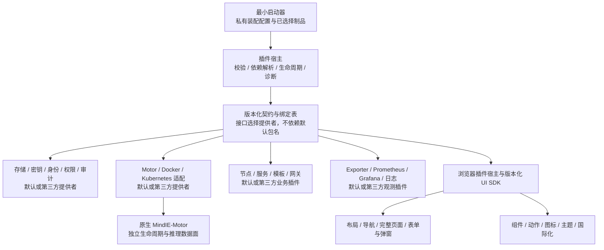

# 可替换插件架构设计

状态：目标设计，尚未实现；不是当前 Manifest schema 的新增字段或导入说明。当前已实现能力见[插件管理](../PLUGINS.md)，源码核对清单见[插件扩展面](../PLUGIN_EXTENSION_POINTS.md)。本设计不改变已有发行版本，也不授权自动迁移数据库、替换执行器或重启模型。

## 1. 目标与最小宿主

平台提供通用宿主、公开 SDK、装配配置及参考插件。业务模块和 UI 均通过版本化契约贡献能力；项目自带实现也是默认插件包，第三方实现按同一规则注册、选择和验证，不修改核心源码即可替换。

宿主只保留运行系统所需的机制：制品校验与启动、配置读取、契约注册、提供者解析、依赖顺序、生命周期、进程通信和故障诊断。默认登录方式、数据库、采集源、Motor 适配器、业务页面、布局、图标和按钮样式都不应在宿主中绑定到具体实现。

安全与一致性要求保留为必须满足的合同，而不是永远绑定某个实现。例如身份源、权限策略和审计输出可以替换，但请求必须经过所选授权合同，关键写操作必须产生审计结果，提供者缺失或初始化失败不能变成免认证或默认成功。后端仍验证每次资源操作，UI 隐藏按钮不能替代授权。

此图描述目标，不表示当前已有这些提供者接口。替换平台适配插件不等于改写原生 Motor 的 Coordinator、Controller、NodeManager 或调度算法。

## 2. 默认实现与第三方实现如何装配

需要建立“能力契约 → 选定提供者”的绑定层，包 ID、契约 ID 和运行实例 ID 分开管理：

| 对象 | 目标规则 |
| --- | --- |
| 契约 | SDK 独立定义输入/输出、错误、版本、权限、超时、幂等、清理及持久状态。调用方不导入默认包私有类。 |
| 提供者 | 自有唯一包 ID，声明实现哪些契约。默认插件与第三方插件使用同一校验器，不靠冒用内置 ID 替换。 |
| 选择 | 管理员显式选择精确版本/摘要；必需的单提供者契约恰好绑定一个实现，零个或多个都在启动前报错。可选契约允许未绑定，消费者须处理明确的不可用状态。 |
| 多提供者 | 模板源、告警渠道、导航贡献等允许集合时，契约明确合并、排序、去重和冲突规则；不隐式覆盖。 |
| 依赖 | 业务依赖稳定契约及版本，绑定后形成具体启动图；冲突、缺失与循环可诊断，不偷偷加载默认包。 |
| 调用 | 同一任务或请求绑定同一提供者代次；配置切换不让已运行操作混用新旧实现。 |
| 停止 | 提供者拥有的任务、连接、订阅、定时器和进程显式登记，逆序停止并有界清理。 |
| 回退 | 保留旧制品与选择记录；代码回退和数据库/插件数据恢复分别执行，不声称换包能撤销外部副作用。 |

初始化依赖有先后，不能都在普通业务工厂阶段才加载：

1. 从独立 bootstrap 配置选择存储、密钥和最低身份/授权合同，再打开持久状态；不能把数据库驱动选择只存进尚未打开的数据库。
2. 装配业务、运行时与观测提供者，注入公开 SDK，再注册路由/任务处理器；宿主不自行创建默认业务对象。
3. Agent 独立解析其本机执行插件与授权。控制面插件导入不自动下发并执行任意节点代码。
4. 浏览器加载与运行中宿主同一代的 UI 插件图；宿主升级导致图不一致时提示保存草稿并刷新，不能混用版本。

插件中心应区分发现/已导入、已选择、等待依赖、启动中、运行中、排空中、失败、停用与需重启。保存配置先对候选装配图整体校验，再以预期修订提交选择；运行图未切换前仍显示原代次。切换失败保留诊断和旧选择，不把“保存成功”报告为“已运行”。

还需要稳定的恢复模式：业务插件无法启动时，提供本机离线检查和选择回退，不依赖已失败的数据库或 UI 插件。恢复入口只用于诊断/恢复装配，不开启默认免认证管理 API，不自动选择另一数据库或认领已有模型。

目标契约目录还需明确状态归属，避免拆包后仍由核心操作插件私有表。下列名称是职责说明，不是当前已发布的 SDK 接口：

| 契约组 | 默认参考实现的责任 | 可替换与持久状态边界 |
| --- | --- | --- |
| Storage / Secret / Identity / Session / Policy | 数据持久化、密钥、认证、会话与授权 | 各实现声明配置、迁移和恢复；跨模块数据通过公开合同访问。 |
| Audit / Logs | 审计结果、运行日志及外部输出 | 约定事务审计或持久 outbox，不能随意换外部输出就丢失关键写入证据。 |
| Model / Template / Image / MotorProfile | 服务配置、模板目录、镜像与原生版本画像 | 配置修订和原生字段独立保存，迁移由持有数据的提供者声明。 |
| Tasks / Lifecycle / AgentConnection | 任务排队、执行协调、节点连接和结果恢复 | 持久任务与回执记录原提供者身份、制品摘要、代次和操作 ID；重启后先按原代次对账。 |
| ResourceInventory / Ledger / Admission / Placement | 观测、资源分配记录、最终准入和布局建议 | 账本写入与建议/指标读取分开；更换来源不自动迁移资源归属或重认领设备。 |
| Runtime / NativeAdapter | Docker/K8s 执行与原生 Motor 接入 | Agent 执行合同独立版本化，进程及外部资源归属可核对；原生部署行为不被 UI 接管。 |
| Telemetry / Metrics / Grafana / Gateway / Reporter | 采集映射、历史查询、观测与外部系统连接 | 来源、权限、设备/集群身份、时效及外部依赖各自明确，不伪造缺失数据。 |
| Maintenance / Backup / Upgrade / PluginPackages | 备份、恢复、升级和插件制品管理 | 插件可换，最小启动器仍能离线校验/撤回选择；恢复不能依赖损坏的业务 UI。 |
| UiShell / Pages / Components / Actions / Icons / Theme / I18n | 完整界面和交互参考实现 | 页面草稿、路由和选择版本分别管理，UI 私有状态不承担业务数据库职责。 |

每个契约在实施前都要列出默认包、独立替代包、调用方及数据拥有者。仅声明这些名称不构成实现；替代插件不能直接接管另一个提供者的私有数据库结构。

## 3. UI 的所有层次都提供替换点

UI 插件应能提供完整交互，不能只开放状态表、导航名称或颜色配置。

| 层次 | 可替换内容 | 需要的合同 |
| --- | --- | --- |
| 完整应用外壳 | 登录页、侧栏、顶栏、布局、工作区、全局搜索与通知 | Shell 生命周期、导航模型、会话状态、路由、草稿及退出协作。 |
| 页面与工作流 | 节点页、模型服务页、部署向导、监控页、设置页及页签 | Route/Page 注册、数据来源、加载/空/失败状态、取消及权限要求。 |
| 组件与插槽 | 表格、表单、抽屉、弹窗、筛选、工具栏、页尾和状态卡片 | Props/事件/状态模型、受控草稿、主题变量、键盘和焦点合同。 |
| 动作与按钮 | 行操作、菜单项、批量操作、快捷键、确认流程及结果反馈 | 稳定动作 ID、上下文、能力声明、幂等键、进度/取消/结果语义；实际写入仍走授权 API。 |
| 图标与品牌 | 导航图标、设备图标、状态符号、品牌资产 | 语义图标 ID → 渲染器/资源映射，尺寸、可访问名称和许可；无需逐页改 import。 |
| 视觉与语言 | 设计系统、字体、间距、圆角、明暗主题、动效与翻译 | Token/组件版本、对比度、减少动态效果、缩放、窄屏和本地化合同。 |

“可替换按钮”包括动作贡献及按钮渲染，不等于第三方直接覆盖 DOM、修改全局点击事件或绕过后端检查。插件包和扩展点是不同粒度：一个包可以提供整套 UI，另一个只提供图标库，也可以贡献多个页面和动作；不需要每个按钮都是独立安装包。

完整 UI 可以按以下两种交付方式演进：

- 构建期 UI 包：默认和第三方包均通过公开 TypeScript SDK 编译，按装配表选取；无需修改宿主源代码，但换包需要重建 Web 制品。
- 独立 UI 制品：受信管理员导入经版本、来源及摘要校验的预构建资源，宿主从本地受控路径提供资源并生成客户端插件图；可以不重建宿主，但需要完整资源加载协议、CSP、依赖共享、版本一致性、回退与故障隔离。当前社区包不支持此方式。

目标应包含独立 UI 制品导入；构建期方案可以作为验证契约的过渡，不能当作无需重建的在线导入已完成。React 懒加载只解决组件加载，不自动提供插件发现、信任、版本、依赖选择或热替换。任意代码 UI 与宿主同浏览器上下文时属于受信代码；需要隔离的第三方页面应另用 iframe/独立 origin 加版本化桥接，并明确可用能力，不能声称天然沙箱。

## 4. 架构与语言选择

建议采用**微内核式插件宿主、接口驱动装配和独立的前后端 SDK**。可以保留已有可靠业务实现，将其逐步放入默认插件，而不是为了新插件架构重写原生 Motor。没有性能瓶颈或隔离需求时，不把每个插件拆成网络微服务。

| 路线 | 有利之处 | 代价与适用范围 |
| --- | --- | --- |
| TypeScript 宿主与 React/TypeScript UI；Motor 适配保留 Python | UI/后端插件作者共享类型与包工具；适合新建统一插件主线。Python 通过版本化进程协议保留原生集成 | 仍需分别维护浏览器 SDK、宿主 SDK 和 Python 进程协议；需迁移现有宿主编排/API并验证取消、超时、回执及恢复。 |
| 保留 Python 宿主，React/TypeScript UI 另设插件 SDK | 复用当前后端与部署校验最多，迁移路径较短 | 需要维护两套 SDK 和一致的 schema；Python 宿主仍须消除固定工厂与内部对象耦合。 |
| Rust 作为完整插件宿主 | 可用于有明确隔离或资源约束需求的执行组件 | 独立二进制插件不能依赖稳定 Rust 原生 ABI；需要 RPC、C ABI 或 Wasm 等单独合同。整项目重写不缩短完整 UI 插件生态的建设。 |

面向新的统一插件宿主，优先评估 TypeScript；面向当前版本低风险迁移，保留 Python 宿主也是有效路线。两者均能实现可替换架构，最终选择须以最小替换原型、部署复杂度及迁移验证为依据，不以语言名宣称企业级或性能提升。原生 Motor/Python 适配可独立于宿主语言演进。

比较原型时还应核对团队维护能力、ARM64 与离线制品、Node/Python 双运行时依赖、实际常驻内存、升级和回滚成本。保留 Python 适配进程时，进程协议须定义消息 schema/大小、请求身份、截止时间、协作取消和背压；任务持久操作 ID、Agent 回执和恢复核对不能丢失。子进程超时、宿主重启或响应丢失均可能留下结果未知的外部操作，不能直接当作失败并自动重放。

TypeScript 路线还必须验证原生 JSON 的无损传输。任意 Motor JSON 不能经普通 JavaScript `number` 中转后丢失超过安全整数范围的值；原始 UTF-8 配置可作为不透明制品传递，在支持无损解析的适配侧处理。结构化跨进程字段须规定大整数、null/未知、时间和单位；摘要/签名按明确字节或规范化算法计算，不以不同语言默认的 `JSON.stringify` 输出互相校验。

Rust 内存安全本身不隔离插件权限；进程隔离、凭据范围和资源预算仍需独立设计。隔离也不能自动撤销已经发往 Docker/Kubernetes 的请求。

Python 提供已安装包的 entry point 发现/加载能力，但平台仍应只加载已审查并明确选择的制品；不能无条件执行环境中所有 entry point。TypeScript 的类型不会替代运行时 schema、RPC 或制品校验；不能只共享一个类型文件就宣称跨版本兼容。

## 5. 如何证明完成了真正的替换

首轮原型至少包含一个默认提供者和一个独立开发的替代提供者，调用方源码保持不变：

1. 替换整套 UI 外壳、一个完整部署页面、动作和图标包；验证路由、深链、按钮权限、草稿、刷新、失败及无障碍。
2. 替换观测来源，分别用单宿主 Exporter 和集群 Prometheus 查询提供者，保留节点身份、单位、时效与未知语义；不能把建议架构当作当前采集能力。
3. 替换数据库提供者，真实验证事务、条件写、审计一致性、迁移、备份与恢复；不能只在清单里列新驱动。
4. 替换 Motor 版本/执行适配器，保留任意原生 JSON、任务归属、资源准入、操作回执及失败恢复，并分别完成 Docker/K8s 业务验收。
5. 禁用默认提供者后正常启动第三方实现；缺失、重复、循环依赖、错误版本和失败工厂均有明确诊断。默认插件不能靠核心私有对象获得替代插件没有的隐藏捷径。
6. 导入但未选择的包不执行；切换和回退不混用提供者代次。执行器、身份和数据库不在有未决操作时强行热换；UI 替换也必须有版本与草稿一致性策略。
7. 独立替换身份、会话、权限、密钥和审计实现，验证会话撤销、跨角色拒绝、CSRF、关键写入的审计一致性、密钥恢复以及切换失败。不能只换登录页面就声称认证提供者可替换。
8. 在宿主/适配进程重启、请求超时、部分成功与响应丢失情况下，按持久化的原提供者代次查询未决操作；验证未授权和未知结果均不被自动放行或重复执行。TypeScript 原型另测大整数、未知 JSON 字段及跨语言摘要一致性。

完成这些证据前，发行说明继续使用“内置可选模块与社区扩展”，不能声称所有模块已可替换。

## 设计参考

- [React 懒加载合同](https://react.dev/reference/react/lazy)：组件代码加载与错误边界。
- [Vite glob import](https://vite.dev/guide/features.html#glob-import)：构建期模块发现，不是任意运行时插件目录。
- [Python 3.12 entry points](https://docs.python.org/3.12/library/importlib.metadata.html#entry-points)：包入口发现与显式加载。
- [Rust ABI 合同](https://doc.rust-lang.org/reference/items/external-blocks.html#abi)：原生 Rust ABI 不提供稳定性保证；独立制品需另设边界。
